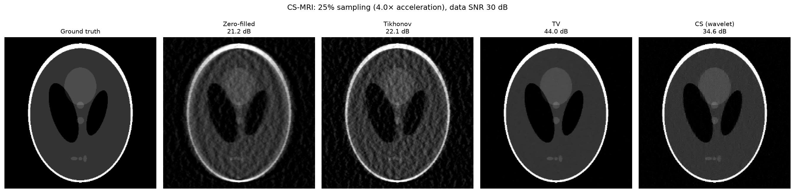
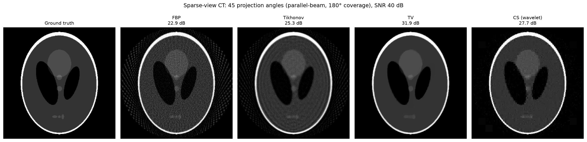

# medimg: Compressed Sensing Reconstruction for Accelerated MRI and CT

[](LICENSE)
[](https://doi.org/10.5281/zenodo.21321199)
[](https://github.com/abdgafartunde/medical-imaging/actions/workflows/tests.yml)

A research-grade Python package for compressed sensing and model-based
image reconstruction in accelerated MRI and sparse-view CT.  Implements
classical variational methods (Tikhonov, total variation, and
wavelet-domain L1 minimisation) with clean operator-based abstractions
that work across both imaging modalities.

## Sample results





Settings and how to regenerate the figures are in [`figures/`](figures/).

## Features

| Module | Description |
|---|---|
| `medimg.forward` | MRI Fourier encoding with variable-density Cartesian masks; parallel-beam CT Radon transform |
| `medimg.reconstruct` | Tikhonov (CG), TV (Chambolle-Pock primal-dual), CS wavelet L1 (FISTA) |
| `medimg.transforms` | Wavelet analysis/synthesis (PyWavelets), soft-thresholding |
| `medimg.phantoms` | Shepp-Logan phantom, custom circle phantoms |
| `medimg.metrics` | PSNR, SSIM (Wang et al. 2004) |
| `medimg.plotting` | Side-by-side reconstruction comparisons, error maps |

## Installation

```bash
git clone https://github.com/abdgafartunde/medical-imaging
cd medical-imaging
pip install -e ".[dev]"
```

Dependencies: `numpy`, `scipy`, `matplotlib`, `scikit-image`, `PyWavelets`.

## Quick start

```python
import numpy as np
from medimg.phantoms import shepp_logan
from medimg.forward import generate_cartesian_mask, mri_forward, mri_adjoint
from medimg.reconstruct import tikhonov_cg, tv_chambolle_pock, cs_fista
from medimg.transforms import wavelet_forward, wavelet_adjoint
from medimg.plotting import plot_reconstructions

# 1. Ground-truth phantom
phantom = shepp_logan((256, 256))

# 2. Variable-density under-sampling mask (4× acceleration)
mask = generate_cartesian_mask(phantom.shape, sampling_rate=0.25,
                               calib_lines=24, rng=42)

# 3. Forward operator: unitary Fourier + mask + noise at sampled locations
#    (noise_std 0.01 gives a data SNR of about 30 dB for this phantom)
kspace = mri_forward(phantom, mask, noise_std=0.01, rng=42)

# 4. Define linear operators
A  = lambda x: mri_forward(x, mask)            # forward
At = lambda y: mri_adjoint(y, mask)            # adjoint
y  = kspace

# 5. Reconstruct
# (the 256 x 256 example in examples/01_mri_cs.py uses 200 CG, 2000 TV, and
#  1000 FISTA iterations; the defaults below are faster but less converged)
x_tik = tikhonov_cg(A, At, y, lambd=1e-3, shape=phantom.shape)
x_tv  = tv_chambolle_pock(A, At, y, alpha=3e-3, shape=phantom.shape)

# 6. CS with wavelet sparsity
W  = lambda x: wavelet_forward(x, wavelet='haar', level=4)
Wt = lambda c: wavelet_adjoint(c, wavelet='haar')
x_cs = cs_fista(A, At, y, W, Wt, lambd=3e-3, shape=phantom.shape)

# 7. Compare
plot_reconstructions(
    [phantom, x_tik, x_tv, x_cs],
    titles=['Ground truth', 'Tikhonov', 'TV', 'CS (wavelet)'],
    suptitle='CS-MRI reconstruction comparison'
)
```

For CT sparse-view reconstruction, replace the forward/adjoint with
`ct_forward` / `ct_adjoint` and generate sparse projection angles.

Both operator pairs are exactly adjoint (the dot-product test
$\langle Ax, y\rangle = \langle x, A^*y\rangle$ holds to rounding error) and
have spectral norm 1, so regularisation parameters are on comparable scales.
The MRI operator uses the unitary FFT; the CT operator is a sparse
parallel-beam projector whose geometry matches `skimage.transform.radon`
(`circle=True`) and whose transpose is the back-projection.

## Documentation

- [docs/medimg-tech-note.pdf](docs/medimg-tech-note.pdf): the technical note,
  with the operators and algorithms as implemented, verification, results,
  parameter guidance, API reference, and limitations.
- [examples/00_getting_started.ipynb](examples/00_getting_started.ipynb): the
  tutorial, MRI and CT step by step, choosing parameters without the true
  image, your own images, and writing your own operator. Start here.
- [THEORY.md](THEORY.md): full mathematical formulation (forward models,
  compressed sensing principles, Tikhonov, TV/Chambolle-Pock, FISTA).
- [examples/01_mri_cs.py](examples/01_mri_cs.py): MRI compressed sensing
  with configurable acceleration factor, noise level (30 dB data SNR by
  default), and regularisation.
- [examples/02_ct_sparse_view.py](examples/02_ct_sparse_view.py): CT
  reconstruction from 45 sparse views with 1% noise, compared with FBP.

Both examples run from any directory, save their figure to `figures/` (or
`--outdir DIR`), and accept `--quick` for a 128 × 128 run of a few seconds.
With the default settings they report:

| | Zero-filled / FBP | Tikhonov | TV | CS (wavelet) |
|---|---|---|---|---|
| MRI, 4× acceleration, 30 dB | 21.2 dB | 22.1 dB | 44.0 dB | 34.7 dB |
| CT, 45 views, 1% noise | 22.9 dB | 25.3 dB | 31.9 dB | 27.7 dB |

Regularisation parameters were chosen by a coarse search for the best PSNR on
the Shepp-Logan phantom, so these numbers are best cases for this phantom.

## Running tests

```bash
pytest          # 69 tests
```

The suite includes dot-product (adjoint) and operator-norm tests for both
modalities, tests of the noise model, and golden-output tests that rerun the
quick configuration of both examples and compare PSNR and SSIM with
[`tests/golden/quick_examples.json`](tests/golden/quick_examples.json).
GitHub Actions runs the tests on Python 3.10 to 3.13. To reproduce the tested
environment exactly, use the lock file: `uv sync --extra dev`.

## References

- Lustig, M., Donoho, D. & Pauly, J.M. (2007). Sparse MRI: the application of
  compressed sensing for rapid MR imaging. *Magnetic Resonance in Medicine*,
  58(6), 1182–1195.
- Sidky, E.Y. & Pan, X. (2008). Image reconstruction in circular cone-beam
  computed tomography by constrained, total-variation minimization. *Physics in
  Medicine and Biology*, 53(17), 4777–4807.
- Chambolle, A. & Pock, T. (2011). A first-order primal-dual algorithm for
  convex problems with applications to imaging. *Journal of Mathematical
  Imaging and Vision*, 40(1), 120–145.
- Beck, A. & Teboulle, M. (2009). A fast iterative shrinkage-thresholding
  algorithm for linear inverse problems. *SIAM Journal on Imaging Sciences*,
  2(1), 183–202.
- Wang, Z., Bovik, A.C., Sheikh, H.R. & Simoncelli, E.P. (2004). Image quality
  assessment: from error visibility to structural similarity. *IEEE
  Transactions on Image Processing*, 13(4), 600–612.

## License

MIT; see [LICENSE](LICENSE).

## Citation

If you use this code in your research, please cite the Zenodo archive
([10.5281/zenodo.21321199](https://doi.org/10.5281/zenodo.21321199), which always resolves to the latest
version); the citation metadata is in [`CITATION.cff`](CITATION.cff).
